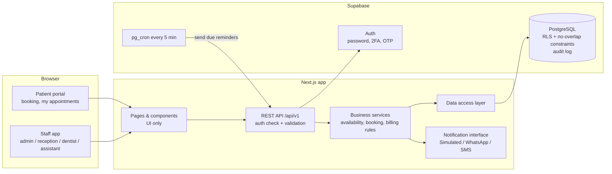
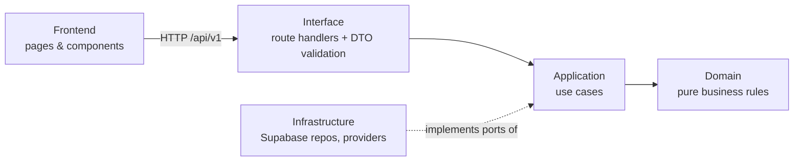

# Dental Clinic MVP — Architecture Overview & Execution Plan

> **Status:** DRAFT v0.2 — awaiting approval · **Date:** 2026-11-23
> Companion to [01-requirements.md](01-requirements.md) · Database: [03-database-design.md](03-database-design.md) · API: [04-api-spec.md](04-api-spec.md)
> v0.2: backend exposed as a versioned **REST API**; folder structure updated to clean-architecture layers.

---

## 1. Recommended Technology Stack

| Layer | Choice | Why (one line) | In plain words |
|---|---|---|---|
| Web app (frontend + backend) | **Next.js** (latest stable, App Router) + **TypeScript** | One project for screens and server logic; type checking catches mistakes early. | One toolbox builds both what users see and the "back office" logic, which keeps the project small. |
| Backend API style | **REST API** at `/api/v1` (Next.js route handlers), spec in [04-api-spec.md](04-api-spec.md) | A clear, documented contract reusable later by a mobile app, WhatsApp provider callbacks, or other systems. | Fixed "service windows" that any future app can use, not just our website. |
| Styling & UI components | **Tailwind CSS** + **shadcn/ui** (Radix-based) | Accessible ready-made components (dialogs, tables, forms) that support right-to-left. | Professional building blocks instead of drawing every button by hand. |
| Language & RTL | **next-intl** + CSS logical properties | Arabic default at `/ar`, English at `/en`; layout flips automatically. | The same screen mirrors correctly for Arabic and English. |
| Database | **PostgreSQL** via **Supabase** | Reliable relational database with built-in rules that can *refuse* double bookings. | A very strict filing cabinet that won't accept two files in the same drawer. |
| Authentication | **Supabase Auth** | Staff email/password, Admin 2FA, patient phone OTP, secure password hashing, all built in. | We don't build our own lock — we use a proven one. |
| Row-level security | **Supabase RLS policies** | Database checks "who is asking" for every row, as a second lock behind the app's checks. | Even if a screen has a bug, the database still won't hand out data the user may not see. |
| Validation | **Zod** (shared schemas) + React Hook Form | Same rules validate the form in the browser and again on the server. | Bad data is stopped at the door and again at the safe. |
| Calendar | **react-big-calendar** (open source, MIT) | Day/week/month, columns per dentist/chair, drag-and-drop, RTL option — no licence fee. | A free, proven calendar we customise; RTL is tested in Phase 0. |
| Charts | **Recharts** | Simple, responsive charts for dashboard and reports. | |
| Dates & time zone | **date-fns** + time-zone helper | All times stored in UTC, shown in Riyadh time. | Prevents "appointment shifted by 3 hours" bugs. |
| Background jobs | **Supabase pg_cron** → calls a protected app endpoint every 5 min | Sends due reminders; works on free tiers. | An alarm clock that wakes the system to send reminders. |
| Notifications | Own **provider interface**; MVP = **Simulated provider** | WhatsApp/SMS/email plug in later without touching business code. | A universal socket: today it lights a test lamp, later a real one. |
| Tests | **Vitest** (business rules) + database tests for the no-overlap rule; a few **Playwright** smoke tests later | The booking rules are the riskiest part, so they get automated tests. | Robots re-check the rules every time we change something. |
| Local development | **Supabase CLI + Docker** (Docker 29.6 is installed ✅; Node 22 ✅; Git ✅) | Full database + auth running on your PC, free. | A private copy of the whole system on your laptop. |
| Hosting (demo) | **Vercel** (app) + **Supabase Cloud** (database) | Cheapest, simplest deployment. Production hosting re-assessed for KSA data residency (Risk R-2). | |

**Not chosen (and why):** separate Express backend — doubles the projects to maintain; Bootstrap — weaker RTL/component story than Tailwind + shadcn for this spec; FullCalendar — dentist/chair column views are a paid licence.

---

## 2. Architecture in One Picture



**Rule of the layers (plain words):** screens only display and collect; *services* hold the clinic's rules (e.g. "no booking under 2 hours"); the *data layer* is the only part that talks to the database. Rules therefore live in one place and can be tested without clicking through screens.

---

## 3. Key Design Decisions

| # | Decision | Why it matters |
|---|---|---|
| D1 | **Double-booking is blocked inside the database** (PostgreSQL exclusion constraint on dentist + time range and chair + time range, ignoring Cancelled/No-show). Admin overrides are marked and excluded from the constraint. | Even two simultaneous clicks cannot both win. The app still checks first to show friendly messages. |
| D2 | **Two security locks:** permission check in every server action **and** row-level security in the database. | Defence in depth for medical data. |
| D3 | **Snapshots:** service name, duration, and price copied onto each appointment / bill line. | Changing a price list never rewrites history. |
| D4 | **UTC storage, Riyadh display.** | Correct times everywhere, including reminders. |
| D5 | **Nothing financial or audit is deleted;** corrections are new entries; audit table is append-only (enforced by DB permissions/triggers). | Trustworthy history and simpler investigations. |
| D6 | **Notification outbox:** booking writes "messages to send" into a table; a sender job delivers them and records the result. | A WhatsApp outage never breaks a booking; every message is traceable. |
| D7 | **Branch-ready:** operational tables carry a `branch_id` (one branch seeded). | Multi-branch later without restructuring — small cost now. |
| D8 | **Bilingual master data:** services, dentist names/specializations stored in AR and EN. | Both languages display properly. |
| D9 | **Synthetic seed data** with one test account per role. | Safe demos; no real patient data ever in development. |

---

## 4. Main Things the System Tracks (no columns yet)

Detailed schema, ERD, and indexes are **Step 0.2** deliverables.

- **Organisation:** clinic, branch, clinic settings, working hours, holidays
- **People & access:** staff user profiles, roles, extra permissions, dentist profiles, assistant↔dentist links
- **Resources:** chairs, services, dentist weekly shifts & breaks, dentist↔chair assignments, schedule blocks/leave, reserved emergency blocks
- **Patients:** patients, guardian↔dependent links, medical info, privacy consent
- **Appointments:** appointments, status history, front-desk notes, clinical notes
- **Billing:** bills, bill lines, discounts (with approval), payments (with void), refunds (with approval), receipt numbering
- **Notifications:** outbox / log, staff alerts
- **Audit:** audit log

---

## 5. Project Folder Structure — Clean Architecture

One repository, with frontend and backend clearly separated inside it. **The dependency rule:** inner layers never know about outer layers.



| Layer | Contains | Knows about | Plain words |
|---|---|---|---|
| **Domain** | Types and pure rules: availability calculation, status transitions, bill maths | nothing else | The clinic's rulebook. No database, no screens, so it's easy to test. |
| **Application** | Use cases (`bookAppointment`, `recordPayment` …) and *ports* (interfaces such as `AppointmentRepository`, `NotificationProvider`) | Domain | The procedures: "to book, check rules → save → notify". |
| **Infrastructure** | Supabase repositories, simulated/WhatsApp providers, clock | Application ports | The plumbing: how data is actually stored and messages sent. Replaceable. |
| **Interface (API)** | REST route handlers, Zod request/response schemas, auth guard, error mapper | Application | The service windows. |
| **Frontend** | Pages, components, forms, API client | API contract only | What users see. |

```
dental-clinic/
├─ docs/                              # PRD, requirements, architecture, DB, API, decisions
├─ supabase/
│  ├─ migrations/                     # versioned SQL: tables, constraints, RLS, triggers, functions
│  ├─ seed.sql                        # synthetic demo data + one test account per role
│  └─ tests/                          # DB tests: no-overlap constraint, RLS per role, audit immutability
├─ src/
│  ├─ app/                            # ── Next.js routing only (thin) ──
│  │  ├─ [locale]/                    # FRONTEND pages (ar default, en)
│  │  │  ├─ (public)/                 # landing, book/, login/, register/, confirmation/
│  │  │  ├─ (patient)/                # my-appointments/, family/, profile/
│  │  │  └─ (staff)/                  # dashboard/, calendar/, appointments/, patients/, dentists/,
│  │  │                               # services/, chairs/, schedules/, payments/, reports/,
│  │  │                               # notifications/, audit-logs/, settings/, staff/
│  │  └─ api/v1/                      # BACKEND route handlers (one folder per resource, call use cases)
│  │
│  ├─ modules/                        # ── BACKEND business modules ──
│  │  ├─ appointments/
│  │  │  ├─ domain/                   # availability.ts, status-machine.ts, booking-rules.ts, types.ts
│  │  │  ├─ application/              # book-appointment.ts, reschedule.ts, change-status.ts, ports.ts
│  │  │  ├─ infrastructure/           # supabase-appointment-repository.ts
│  │  │  └─ api/                      # schemas.ts (Zod DTOs), handlers.ts
│  │  ├─ scheduling/                  # dentists, shifts, chairs, services, blocks, clinic hours
│  │  ├─ patients/                    # patients, family, duplicates, medical info, clinical notes
│  │  ├─ billing/                     # bills, discounts, payments, refunds, receipts
│  │  ├─ notifications/               # NotificationProvider port, simulated + future WhatsApp/SMS adapters
│  │  ├─ reports/                     # dashboards & report queries
│  │  ├─ identity/                    # auth, staff users, roles, permissions
│  │  └─ audit/
│  │
│  ├─ shared/                         # ── cross-cutting ──
│  │  ├─ kernel/                      # Result/AppError types, money, clock, ids
│  │  ├─ auth/                        # session reader, requireRole(), permission checks
│  │  ├─ http/                        # response envelope, error → status mapping, idempotency
│  │  ├─ db/                          # Supabase clients (user-scoped / service)
│  │  ├─ i18n/                        # next-intl config, RTL helpers
│  │  └─ time/                        # Riyadh ⇄ UTC helpers
│  │
│  ├─ ui/                             # ── FRONTEND shared ──
│  │  ├─ components/                  # design system (shadcn/ui), status badges, empty/loading/error states
│  │  ├─ features/                    # feature components: booking-wizard/, calendar/, patient-profile/…
│  │  ├─ api-client/                  # typed fetch wrapper for /api/v1
│  │  └─ hooks/
│  └─ messages/                       # ar.json, en.json (all UI text)
├─ tests/
│  ├─ unit/                           # domain rules (availability, transitions, bill maths)
│  ├─ integration/                    # use cases + API against local Supabase
│  └─ e2e/                            # a few Playwright smoke tests (booking, check-in, payment)
├─ .env.example                       # variable names only, never real secrets
├─ CLAUDE.md                          # working rules for AI-assisted development
└─ README.md
```

**Reading data on server-rendered pages:** pages may call the same *application use cases* directly instead of calling their own API over HTTP. It's one set of rules with two doors, and both doors run the same permission checks.

---

## 6. Execution Plan on Claude Code (step by step)

**How every step works:**
1. I post a short *micro-plan*: what, why, which files.
2. I build only that step.
3. I run tests or show you how to check it.
4. I give a checklist plus **"compared with the spec: missing / extra"**.
5. **STOP** — I continue only after your approval.

### Phase order — your order vs. recommended

| # | Your order | Recommended order | Reason for the change |
|---|---|---|---|
| 0 | — | **Foundation** (setup, schema, login, roles, Arabic/RTL layout) | Every module needs login, roles, and the database first. |
| 1 | Dashboard | **Dashboard** (shell + KPI cards on seed data) | Kept first so you see visible progress early. |
| 2 | Appointments | **Dentists, services, chairs, schedules** | Booking cannot calculate free times without dentists' hours and chairs. Building them first avoids rework. |
| 3 | Patients | **Appointments** (+ booking portal, calendar, notifications) | Includes a quick "register patient" form needed for booking. |
| 4 | Dentists | **Patients** (profile, family, duplicates, medical, clinical notes) | |
| 5 | Payments | **Payments** | Same. |
| 6 | Reports | **Reports** (+ audit log & notification log screens) | Same. |
| 7 | — | **Testing, hardening, deployment** | Required by your spec (§16 phases 8–9). |

### Phase 0 — Foundation · complexity: Medium

| Step | Deliverable | Done when |
|---|---|---|
| 0.1 | Project folder (outside OneDrive), `git init`, `CLAUDE.md` with our working rules | Folder and repo exist |
| 0.2 | **Detailed database schema + ERD + RLS matrix** ([03](03-database-design.md)) and **REST API spec** ([04](04-api-spec.md)) — documents only · *drafted, awaiting approval* | **You approve schema & API** |
| 0.3 | Scaffold Next.js + TypeScript + Tailwind + shadcn/ui + lint + Vitest | Empty app runs at `localhost:3000` |
| 0.4 | Local Supabase; first migrations (core tables); synthetic seed; test accounts per role | `supabase db reset` builds DB with demo data |
| 0.5 | Arabic/English + RTL/LTR, fonts, app shell (sidebar, header, language switch); calendar RTL spike | Layout mirrors correctly in both languages |
| 0.6 | Staff login + Admin 2FA; patient OTP (simulated); role-protected routes; audit helper | Each test account sees only its own menu; forbidden URLs blocked |

### Phase 1 — Dashboard · complexity: Small–Medium

| Step | Deliverable | Done when |
|---|---|---|
| 1.1 | Admin dashboard KPI cards + period selector (reads seed data) | Numbers match the seed data |
| 1.2 | Reception and dentist dashboards; loading / empty / error states | Each role lands on its own dashboard |

### Phase 2 — Dentists & Scheduling Setup · complexity: Medium

| Step | Deliverable | Done when |
|---|---|---|
| 2.1 | Services management (AR/EN, duration, price, online flag) | CRUD + validation + audit |
| 2.2 | Chairs management | CRUD |
| 2.3 | Dentist profiles (+ photo), chair assignments, assistant links | CRUD |
| 2.4 | Weekly schedules, breaks, clinic hours & holidays, leave/blocks | Schedules visible per dentist |

### Phase 3 — Appointments · complexity: **Large** (core of the system)

| Step | Deliverable | Done when |
|---|---|---|
| 3.1 | **Availability engine** + automated tests (hours, breaks, leave, chairs, 2 h / 90 d rules) | All rule tests pass |
| 3.2 | Staff booking (phone / walk-in / emergency) + quick patient registration + DB no-overlap constraint + Admin override | Double-booking impossible (tested) |
| 3.3 | Status workflow + reception check-in queue | Allowed/forbidden transitions tested |
| 3.4 | Calendar: day/week/month, by dentist, by chair, drag-and-drop reschedule | Moves validated and audited |
| 3.5 | Public booking portal (7 steps) + OTP + family + "my appointments" cancel/reschedule (24 h rule) | End-to-end booking works on mobile |
| 3.6 | Notification outbox + simulated provider + reminders job + staff alerts + dentist-absence reassignment | Messages appear in the log at the right times |

### Phase 4 — Patients · complexity: Medium

| Step | Deliverable | Done when |
|---|---|---|
| 4.1 | Patient list, search, profile, appointment history, no-show count | |
| 4.2 | Duplicate detection & review flag; guardian/dependent management | |
| 4.3 | Medical info (restricted, access logged) + clinical notes + follow-up booking | Receptionist cannot see restricted data (tested) |

### Phase 5 — Payments · complexity: Medium

| Step | Deliverable | Done when |
|---|---|---|
| 5.1 | Bills, lines, VAT settings, discounts with approval | Totals calculated correctly (tested) |
| 5.2 | Payments (partial), balances, printable bilingual receipt | |
| 5.3 | Refund request/approval, payment void | |

### Phase 6 — Reports · complexity: Medium

| Step | Deliverable | Done when |
|---|---|---|
| 6.1 | Appointment reports + charts + filters | Figures match metric definitions (RPT-05) |
| 6.2 | Financial reports (revenue, payments, outstanding) | |
| 6.3 | Audit log viewer + notification log viewer | Admin-only |

### Phase 7 — Test, Harden, Deploy · complexity: Medium

| Step | Deliverable |
|---|---|
| 7.1 | Permission review per role, booking-conflict tests, RTL & mobile review, bug fixes |
| 7.2 | Deploy demo (Vercel + Supabase Cloud), environment variables, cron job |
| 7.3 | README, setup guide, test credentials, known limitations, production-readiness checklist (PDPL residency, ZATCA, WhatsApp provider) |

---

## 7. What I Need From You to Start

1. Answers to the **blocking questions Q-01 to Q-04** (and "default" for the rest if you agree).
2. Approval of the **requirements** ([01-requirements.md](01-requirements.md)).
3. Approval of the **stack** and **phase order** above.

Then the next deliverable is **Step 0.1 → 0.2: project folder + detailed database schema & ERD** — still no application code.
