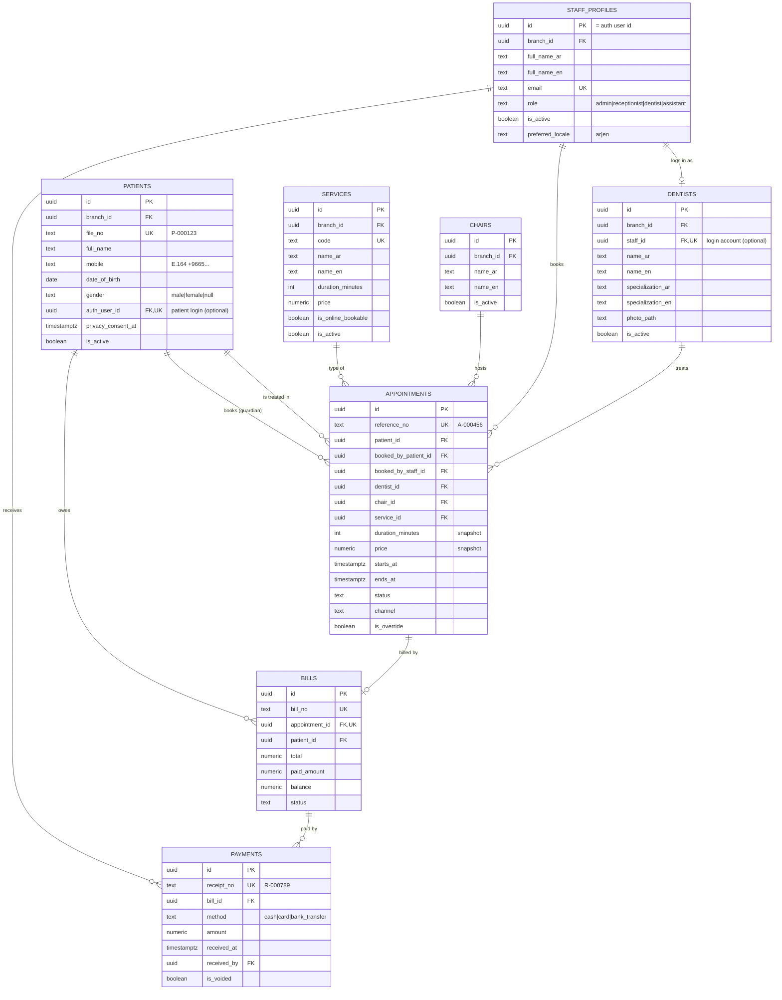
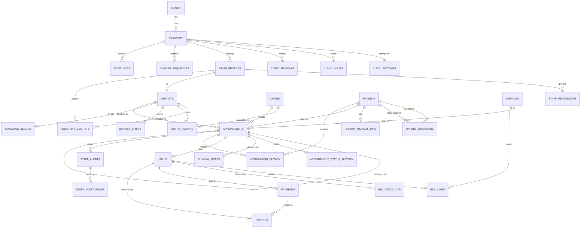

# Dental Clinic MVP — Database Design (PostgreSQL)

> **Status:** DRAFT v0.1 — awaiting approval · **Date:** 2026-11-23
> **Engine:** PostgreSQL 15+ (hosted by Supabase) · Requires extensions `pgcrypto`, `btree_gist`, `pg_trgm`, `pg_cron`.
> Built on [01-requirements.md](01-requirements.md) using the **suggested defaults** for open questions. Tables affected by a default are tagged **[Q-xx]**.

---

## 1. Conventions (plain words first)

| Rule | Meaning for the business |
|---|---|
| Every table has an `id` of type `uuid` (random, unguessable). Audit and history tables use a growing number. | Record numbers can't be guessed from a URL. |
| Human-friendly numbers (`P-000123`, `A-000456`, `R-000789`) are separate columns. | Staff read short numbers; the system uses safe internal IDs. |
| All times are `timestamptz` (stored in UTC, shown in Riyadh time). Pure dates use `date`; clock times use `time`. | No time-zone mistakes. |
| Money is `numeric(10,2)` in SAR. | No rounding errors (never floating point). |
| Fixed lists (status, role, method…) are `text` + `CHECK (... IN (...))`. | Easy to extend later without a complex migration. |
| Standard columns `created_at`, `updated_at`, `created_by`, `updated_by` on business tables (omitted from the tables below for brevity unless special). | Who/when on every record. |
| `branch_id` on operational tables. | Ready for more branches later. |
| No hard deletes for patients, appointments, or anything financial; `is_active` / status / void instead. | History is never lost. |
| Arabic + English columns (`_ar`, `_en`) for names shown to patients. | Bilingual display. |

---

## 2. Entity-Relationship Diagrams

### 2.1 Core entities with attributes

Shows Patients, Appointments, Dentists (Doctors), Services, Payments, and Users.



### 2.2 Full relationship map (all 30 tables)



---

## 3. Tables

Grouped as: **A** Organisation · **B** Staff & access · **C** Resources & scheduling · **D** Patients · **E** Appointments & clinical · **F** Billing · **G** Notifications · **H** Audit.

### A. Organisation

#### A1. `clinics` — the clinic's legal and contact profile (one row in the MVP)
| Column | Type | Constraints / notes |
|---|---|---|
| id | uuid | PK, default `gen_random_uuid()` |
| name_ar, name_en | text | NOT NULL |
| legal_name | text | |
| vat_registration_no | text | 15 digits if set: `CHECK (vat_registration_no ~ '^[0-9]{15}$')` |
| logo_path | text | storage path |

#### A2. `branches`
| Column | Type | Constraints / notes |
|---|---|---|
| id | uuid | PK |
| clinic_id | uuid | FK → clinics, NOT NULL |
| name_ar, name_en | text | NOT NULL |
| address_ar, address_en | text | |
| phone, whatsapp | text | E.164 |
| email | text | |
| timezone | text | NOT NULL default `'Asia/Riyadh'` |
| currency | text | NOT NULL default `'SAR'` |
| is_active | boolean | NOT NULL default true |

#### A3. `clinic_settings` — booking, billing, and notification rules (one row per branch)
| Column | Type | Default | Constraints / notes |
|---|---|---|---|
| branch_id | uuid | | **PK**, FK → branches |
| online_min_notice_minutes | int | 120 | ≥ 0 |
| online_max_advance_days | int | 90 | 1–365 |
| online_change_cutoff_hours | int | 24 | ≥ 0 |
| slot_interval_minutes | int | 15 | IN (5,10,15,20,30) |
| buffer_minutes | int | 0 | 0–60 |
| max_upcoming_online_per_patient | int | 3 | ≥ 1 **[Q-25]** |
| no_show_suggest_after_minutes | int | 15 | **[Q-27]** |
| vat_enabled | boolean | true | |
| vat_rate | numeric(5,2) | 15.00 | 0–100 |
| prices_include_vat | boolean | false | **[Q-06]** |
| receptionist_max_discount_pct | numeric(5,2) | 10.00 | 0–100 **[Q-13]** |
| clinical_note_edit_hours | int | 24 | **[Q-22]** |
| staff_idle_timeout_minutes | int | 30 | |
| reminder_24h_enabled, reminder_2h_enabled | boolean | true | |
| default_channel | text | 'whatsapp' | IN ('whatsapp','sms','email') |
| updated_at / updated_by | | | |

#### A4. `clinic_hours` — opening shifts per weekday (several rows per day = split shifts)
| Column | Type | Constraints / notes |
|---|---|---|
| id | uuid | PK |
| branch_id | uuid | FK, NOT NULL |
| weekday | smallint | 0 = Sunday … 6 = Saturday, `CHECK (weekday BETWEEN 0 AND 6)` |
| start_time, end_time | time | `CHECK (end_time > start_time)` |
| valid_from, valid_to | date | NULL = always; a dated row (e.g. Ramadan) **replaces** undated rows for that weekday inside its range **[Q-14]** |

Index: `(branch_id, weekday)`.

#### A5. `clinic_holidays`
| Column | Type | Constraints / notes |
|---|---|---|
| id | uuid | PK |
| branch_id | uuid | FK |
| date_from, date_to | date | `CHECK (date_to >= date_from)` |
| name_ar, name_en | text | |

Index: `(branch_id, date_from, date_to)`.

### B. Staff & access

#### B1. `staff_profiles` — one row per staff login (the "Users" entity for staff)
| Column | Type | Constraints / notes |
|---|---|---|
| id | uuid | **PK and FK → `auth.users(id)`** (password, 2FA, sessions are handled by Supabase Auth) |
| branch_id | uuid | FK |
| full_name_ar, full_name_en | text | NOT NULL |
| email | text | NOT NULL, UNIQUE (case-insensitive: unique index on `lower(email)`) |
| phone | text | |
| role | text | NOT NULL, IN ('admin','receptionist','dentist','assistant') |
| preferred_locale | text | default 'ar', IN ('ar','en') |
| is_active | boolean | default true |
| last_login_at | timestamptz | |

#### B2. `staff_permissions` — extra switches on top of the role (ADM-03)
| Column | Type | Constraints / notes |
|---|---|---|
| staff_id | uuid | FK → staff_profiles, part of **PK** |
| permission | text | part of **PK**, IN ('medical.view','discount.approve','refund.approve','reports.financial','schedule.block') |
| granted_by | uuid | FK → staff_profiles |
| granted_at | timestamptz | default now() |

### C. Resources & scheduling

#### C1. `dentists` (the "Doctors" entity)
| Column | Type | Constraints / notes |
|---|---|---|
| id | uuid | PK |
| branch_id | uuid | FK |
| staff_id | uuid | FK → staff_profiles, UNIQUE, NULL allowed (profile can exist before a login) |
| name_ar, name_en | text | NOT NULL |
| specialization_ar, specialization_en | text | |
| bio_ar, bio_en | text | |
| photo_path | text | |
| phone, email | text | |
| display_order | int | default 0 |
| accepts_online_booking | boolean | default true |
| is_active | boolean | default true |

#### C2. `assistant_dentists` — which assistant works with which dentist
| Column | Type | Constraints |
|---|---|---|
| assistant_id | uuid | FK → staff_profiles (role must be 'assistant', checked in app + trigger), PK part |
| dentist_id | uuid | FK → dentists, PK part |

#### C3. `chairs`
| Column | Type | Constraints |
|---|---|---|
| id | uuid | PK |
| branch_id | uuid | FK |
| name_ar, name_en | text | NOT NULL; UNIQUE (branch_id, name_en) |
| notes | text | |
| is_active | boolean | default true |

#### C4. `dentist_chairs`
| Column | Type | Constraints |
|---|---|---|
| dentist_id | uuid | FK, PK part |
| chair_id | uuid | FK, PK part |
| is_preferred | boolean | default false; **partial unique index** `(dentist_id) WHERE is_preferred` → at most one preferred chair |

#### C5. `services`
| Column | Type | Constraints |
|---|---|---|
| id | uuid | PK |
| branch_id | uuid | FK |
| code | text | UNIQUE (branch_id, code), e.g. `CONSULT`, `CLEAN`, `FILL`, `RCT`, `EXTRACT`, `EMERG`, `FOLLOWUP` |
| name_ar, name_en | text | NOT NULL |
| description_ar, description_en | text | |
| duration_minutes | int | NOT NULL, `CHECK (duration_minutes BETWEEN 5 AND 480)` |
| price | numeric(10,2) | NOT NULL, ≥ 0 |
| color | text | hex `#RRGGBB` |
| is_online_bookable | boolean | default true (Emergency seeded as false) |
| is_active | boolean | default true |
| display_order | int | |

*(Future: `dentist_services` to restrict services per dentist — not in MVP **[Q-08]**.)*

#### C6. `dentist_shifts` — weekly working hours (gaps between shifts = breaks)
| Column | Type | Constraints |
|---|---|---|
| id | uuid | PK |
| dentist_id | uuid | FK, NOT NULL |
| weekday | smallint | 0–6 |
| start_time, end_time | time | `end_time > start_time` |
| valid_from, valid_to | date | NULL = always; dated rows override (same rule as clinic_hours) |

Index: `(dentist_id, weekday)`. Overlapping shifts for the same dentist/weekday rejected by the application.

#### C7. `schedule_blocks` — leave, blocked time, reserved emergency time
| Column | Type | Constraints |
|---|---|---|
| id | uuid | PK |
| branch_id | uuid | FK |
| dentist_id | uuid | FK, NOT NULL |
| block_type | text | IN ('leave','block','emergency_reserve') |
| starts_at, ends_at | timestamptz | `ends_at > starts_at` |
| reason | text | |
| created_by | uuid | FK → staff_profiles |

Index: GiST on `(dentist_id, tstzrange(starts_at, ends_at))` for fast overlap lookup.

### D. Patients

#### D1. `patients`
| Column | Type | Constraints / notes |
|---|---|---|
| id | uuid | PK |
| branch_id | uuid | FK (branch where registered) |
| file_no | text | NOT NULL, UNIQUE, generated via `number_sequences` ('P-000123') |
| full_name | text | NOT NULL, 2–150 chars |
| mobile | text | E.164 `^\+9665[0-9]{8}$` (Saudi mobile) — NULL allowed **only** for dependents (rule enforced by application + trigger) |
| date_of_birth | date | NOT NULL; not in future (validated in app) |
| gender | text | NULL or IN ('male','female') |
| email | text | |
| national_id | text | NULL or `^[12][0-9]{9}$` (Saudi ID / Iqama format) |
| emergency_contact_name | text | |
| emergency_contact_mobile | text | |
| preferred_locale | text | default 'ar' |
| auth_user_id | uuid | FK → auth.users, UNIQUE, NULL = no online account |
| privacy_consent_at | timestamptz | set on self-registration |
| possible_duplicate_of | uuid | FK → patients, NULL |
| duplicate_review_status | text | default 'none', IN ('none','pending','not_duplicate') **[Q-20]** |
| no_show_count | int | default 0 (maintained by trigger) |
| is_active | boolean | default true |
| created_by | uuid | staff id, NULL when self-registered |

Indexes: `(mobile, date_of_birth)` — duplicate check · `(mobile)` · GIN trigram on `full_name` — fast Arabic/English partial search · `(file_no)` unique.

#### D2. `patient_guardians` — family links
| Column | Type | Constraints |
|---|---|---|
| guardian_patient_id | uuid | FK → patients, PK part |
| dependent_patient_id | uuid | FK → patients, PK part; `CHECK (guardian_patient_id <> dependent_patient_id)` |
| relationship | text | IN ('child','spouse','parent','sibling','other') — what the dependent is to the guardian |
| created_at | timestamptz | |

Index: `(dependent_patient_id)`.

#### D3. `patient_medical_info` — **restricted** (separate table so access rules are strict)
| Column | Type | Constraints |
|---|---|---|
| patient_id | uuid | **PK**, FK → patients |
| allergies | text | ≤ 2000 chars |
| medical_conditions | text | ≤ 2000 |
| current_medications | text | ≤ 2000 |
| medical_notes | text | ≤ 4000 |
| updated_at, updated_by | | |

Read only through the database function `get_patient_medical(patient_id)`, which checks permission **and writes an audit entry for every view**.

### E. Appointments & clinical

#### E1. `appointments`
| Column | Type | Constraints / notes |
|---|---|---|
| id | uuid | PK |
| branch_id | uuid | FK |
| reference_no | text | UNIQUE ('A-000456') — unchanged on reschedule |
| patient_id | uuid | FK → patients, NOT NULL — who is treated |
| booked_by_patient_id | uuid | FK → patients — guardian/self when booked online |
| booked_by_staff_id | uuid | FK → staff_profiles — when booked by staff |
| channel | text | IN ('online','phone','walk_in','emergency') |
| dentist_id | uuid | FK, NOT NULL |
| chair_id | uuid | FK, NOT NULL |
| service_id | uuid | FK, NOT NULL |
| service_name_ar, service_name_en | text | snapshot |
| duration_minutes | int | snapshot |
| price | numeric(10,2) | snapshot |
| starts_at, ends_at | timestamptz | `CHECK (ends_at > starts_at)` |
| status | text | IN ('booked','checked_in','in_treatment','completed','cancelled','no_show'), default 'booked' |
| is_override | boolean | default false |
| override_reason | text | `CHECK (NOT is_override OR override_reason IS NOT NULL)` |
| frontdesk_note | text | ≤ 500 |
| cancel_reason | text | |
| cancelled_by_type | text | NULL or IN ('patient','staff') |
| checked_in_at, treatment_started_at, completed_at, cancelled_at, no_show_at | timestamptz | set on status change |
| follow_up_of | uuid | FK → appointments |
| version | int | default 1 — increases on every update; protects against two staff editing the same appointment at once |

`CHECK (booked_by_patient_id IS NOT NULL OR booked_by_staff_id IS NOT NULL)`

**The no-double-booking guarantee (D1):**
```
EXCLUDE USING gist (dentist_id WITH =, tstzrange(starts_at, ends_at, '[)') WITH &&)
  WHERE (status NOT IN ('cancelled','no_show') AND NOT is_override)
EXCLUDE USING gist (chair_id   WITH =, tstzrange(starts_at, ends_at, '[)') WITH &&)
  WHERE (status NOT IN ('cancelled','no_show') AND NOT is_override)
```
*Plain words:* the database refuses to store two active appointments that overlap for the same dentist or the same chair. `[)` means 10:00–10:30 and 10:30–11:00 do **not** clash. Admin-overridden appointments are excluded and highlighted.

Indexes: `(dentist_id, starts_at)` · `(chair_id, starts_at)` · `(patient_id, starts_at DESC)` · `(branch_id, starts_at)` · `(status, starts_at)` · `(booked_by_patient_id)`.

Triggers: bump `version` + `updated_at`; write `appointment_status_history` when status changes; maintain `patients.no_show_count`; write audit entries.

#### E2. `appointment_status_history`
| Column | Type | Constraints |
|---|---|---|
| id | bigint | PK, identity |
| appointment_id | uuid | FK, NOT NULL |
| from_status, to_status | text | |
| reason | text | |
| changed_by_staff_id | uuid | FK |
| changed_by_patient_id | uuid | FK |
| changed_at | timestamptz | default now() |

Index: `(appointment_id, changed_at)`. Written only by trigger.

#### E3. `clinical_notes` — **restricted**
| Column | Type | Constraints |
|---|---|---|
| id | uuid | PK |
| appointment_id | uuid | FK, NOT NULL |
| patient_id | uuid | FK, NOT NULL (copied for fast access checks) |
| dentist_id | uuid | FK, NOT NULL |
| note | text | NOT NULL, 1–10000 chars |
| parent_note_id | uuid | FK → clinical_notes; set when this is an addendum |
| created_by | uuid | FK → staff_profiles |
| created_at, updated_at | timestamptz | editable only within `clinical_note_edit_hours` and only by its author (RLS) |

Indexes: `(patient_id, created_at DESC)` · `(appointment_id)`.

### F. Billing

#### F1. `bills` — one per appointment (totals kept up to date by the database)
| Column | Type | Constraints / notes |
|---|---|---|
| id | uuid | PK |
| branch_id | uuid | FK |
| bill_no | text | UNIQUE |
| appointment_id | uuid | FK, UNIQUE (NULL allowed for future non-appointment bills) |
| patient_id | uuid | FK, NOT NULL |
| subtotal | numeric(10,2) | sum of lines |
| discount_amount | numeric(10,2) | approved discount only |
| vat_rate | numeric(5,2) | copied from settings when bill is created |
| vat_amount | numeric(10,2) | |
| total | numeric(10,2) | |
| paid_amount | numeric(10,2) | non-voided payments |
| refunded_amount | numeric(10,2) | approved refunds |
| balance | numeric(10,2) | `total − paid_amount + refunded_amount` |
| status | text | IN ('unpaid','partially_paid','paid','void') |

`CHECK (paid_amount <= total)` · Index: `(patient_id)` · `(status)` · partial index `(branch_id) WHERE balance > 0` for the outstanding report.
Trigger `recalc_bill()` runs after any change to lines, discounts, payments, or refunds.

#### F2. `bill_lines`
| Column | Type | Constraints |
|---|---|---|
| id | uuid | PK |
| bill_id | uuid | FK, NOT NULL |
| service_id | uuid | FK, NULL allowed |
| description_ar, description_en | text | NOT NULL (snapshot) |
| quantity | int | default 1, > 0 |
| unit_price | numeric(10,2) | ≥ 0 |
| line_total | numeric(10,2) | generated: `quantity * unit_price` |
| added_by | uuid | FK |

Lines can't be changed once the bill has a payment (trigger) — corrections via refund **[Q-12]**.

#### F3. `bill_discounts`
| Column | Type | Constraints |
|---|---|---|
| id | uuid | PK |
| bill_id | uuid | FK |
| discount_type | text | IN ('percent','fixed') |
| value | numeric(10,2) | > 0; percent ≤ 100 |
| amount | numeric(10,2) | calculated SAR value |
| reason | text | NOT NULL |
| status | text | IN ('pending','approved','rejected') |
| requested_by / requested_at | | |
| decided_by / decided_at | | |

Partial unique index `(bill_id) WHERE status IN ('pending','approved')` → one active discount per bill.

#### F4. `payments`
| Column | Type | Constraints |
|---|---|---|
| id | uuid | PK |
| bill_id | uuid | FK, NOT NULL |
| receipt_no | text | UNIQUE ('R-000789'), gap-free via `number_sequences` |
| method | text | IN ('cash','card','bank_transfer') |
| amount | numeric(10,2) | > 0 |
| reference | text | card last 4 / transfer ref |
| received_at | timestamptz | default now() |
| received_by | uuid | FK → staff_profiles |
| idempotency_key | text | UNIQUE — stops a double-click recording the payment twice |
| is_voided | boolean | default false |
| void_reason / voided_by / voided_at | | `CHECK (NOT is_voided OR void_reason IS NOT NULL)` |

Index: `(bill_id)` · `(received_at)` · `(method, received_at)`.

#### F5. `refunds`
| Column | Type | Constraints |
|---|---|---|
| id | uuid | PK |
| bill_id | uuid | FK |
| payment_id | uuid | FK, NULL allowed |
| refund_no | text | UNIQUE |
| amount | numeric(10,2) | > 0; ≤ paid − already refunded (trigger) |
| method | text | IN ('cash','card','bank_transfer') |
| reason | text | NOT NULL |
| status | text | IN ('requested','approved','rejected') |
| requested_by / requested_at | | |
| decided_by / decided_at | | |

#### F6. `number_sequences` — gap-free document numbers
| Column | Type | Constraints |
|---|---|---|
| branch_id | uuid | PK part |
| doc_type | text | PK part, IN ('patient','appointment','bill','receipt','refund') |
| prefix | text | e.g. 'P-', 'A-', 'B-', 'R-', 'RF-' |
| next_value | bigint | |

Used only through the function `next_number(branch_id, doc_type)` (row lock → no duplicates, no gaps).

### G. Notifications

#### G1. `notification_outbox` — every patient message (queue **and** log)
| Column | Type | Constraints |
|---|---|---|
| id | uuid | PK |
| branch_id | uuid | FK |
| appointment_id | uuid | FK, NULL (OTP messages have none) |
| patient_id | uuid | FK, NULL |
| channel | text | IN ('whatsapp','sms','email') |
| recipient | text | mobile / email |
| template_key | text | IN ('booking_confirmed','reminder_24h','reminder_2h','cancelled','rescheduled','dentist_absence','follow_up','otp') |
| locale | text | 'ar' / 'en' |
| payload | jsonb | values for the template |
| dedupe_key | text | UNIQUE, e.g. `reminder_24h:<appointment>:<starts_at>` → each reminder sent at most once |
| scheduled_for | timestamptz | |
| status | text | IN ('pending','sent','failed','simulated','skipped') |
| attempts | int | default 0 |
| provider | text | 'simulated', later 'whatsapp_cloud', … |
| provider_message_id | text | |
| last_error | text | |
| sent_at | timestamptz | |

Indexes: `(status, scheduled_for)` · `(appointment_id)` · `(created_at)`.
*Design note:* reminders are **not** pre-queued. Every 5 minutes the job looks for Booked appointments that are due a reminder and queues/sends them. Cancelled or moved appointments therefore never get a stale reminder, and nothing needs cleaning up.

#### G2. `staff_alerts`
| Column | Type | Constraints |
|---|---|---|
| id | uuid | PK |
| branch_id | uuid | FK |
| alert_type | text | IN ('new_online_booking','cancellation','reschedule','emergency_booking','discount_pending','refund_requested') |
| target_role | text | IN ('receptionist','admin') |
| appointment_id | uuid | FK, NULL |
| message_ar, message_en | text | |
| created_at | timestamptz | |

#### G3. `staff_alert_reads`
| Column | Type | Constraints |
|---|---|---|
| alert_id | uuid | FK, PK part |
| staff_id | uuid | FK, PK part |
| read_at | timestamptz | |

### H. Audit

#### H1. `audit_logs` — append-only
| Column | Type | Constraints |
|---|---|---|
| id | bigint | PK, identity |
| branch_id | uuid | |
| occurred_at | timestamptz | default now() |
| actor_type | text | IN ('staff','patient','system') |
| actor_id | uuid | |
| actor_role | text | |
| action | text | e.g. `appointment.create`, `appointment.status_change`, `appointment.override`, `patient.update`, `medical.view`, `payment.create`, `payment.void`, `refund.approve`, `staff.permission_change`, `settings.update`, `auth.staff_login` |
| entity_type | text | |
| entity_id | uuid | |
| before, after | jsonb | changed fields only; medical text is **not** copied into the log, only "changed" markers |
| reason | text | |
| ip | inet | |

Indexes: `(entity_type, entity_id)` · `(actor_id, occurred_at DESC)` · `(occurred_at DESC)` · `(action)`.
Protection: no UPDATE/DELETE privileges for any app role **plus** a trigger that rejects updates/deletes.

---

## 4. Database Functions & Triggers (kept deliberately few)

| Name | Type | Purpose |
|---|---|---|
| `next_number(branch, doc_type)` | function | Gap-free human numbers |
| `get_patient_medical(patient_id)` | security-definer function | Permission check + audit "medical.view" + return data |
| `busy_intervals(branch, from, to)` | security-definer function | Returns only dentist/chair busy times (**no patient data**) for public availability |
| `recalc_bill()` | trigger | Keeps bill totals and status correct |
| `trg_appointment_change` | trigger | version, updated_at, status history, no-show count |
| `trg_audit_*` | triggers on key tables | Writes audit rows with before/after, so no code path can forget |
| `trg_block_audit_mutation` | trigger | Rejects UPDATE/DELETE on audit_logs |
| `report_*` | SQL functions | Fast aggregate reports (appointments, revenue, utilization…) |

**Where the business rules live (plain words):** the *decisions* (is this time allowed? is this discount above the limit? can this patient still cancel?) live in the TypeScript application layer, where they are tested. The database adds **safety nets** that must never fail: no overlaps, no deleting history, totals always consistent.

---

## 5. Row-Level Security (database "second lock")

Helper functions read the logged-in user: `auth_role()`, `auth_has_perm(p)`, `auth_dentist_id()`, `auth_assistant_dentist_ids()`, `auth_patient_ids()` (own + dependents).

| Table | Admin | Receptionist | Dentist | Assistant | Patient | Anonymous |
|---|---|---|---|---|---|---|
| clinic, branches, settings, hours, holidays | RW | R | R | R | R (public fields) | R (public fields) |
| staff_profiles, staff_permissions | RW | R (names only) | R (names only) | R (names only) | — | — |
| dentists, services, chairs, shifts | RW | R | R | R | R (active) | R (active) |
| schedule_blocks | RW | RW | R own | R linked | — | — |
| patients, patient_guardians | RW | RW | R (own patients) | R (linked appointments) | RW own + dependents (limited columns) | — |
| patient_medical_info | via function (logged) | via function if `medical.view` | via function, own patients; write own patients | — | — | — |
| appointments | RW | RW | R own; status update own | R linked; status 'in_treatment' only | R own + dependents (writes through API only) | — |
| clinical_notes | R | — | RW own (edit window) / R own patients | — | — | — |
| bills, lines, discounts, payments, refunds | RW | RW (no approve) | — | — | — | — |
| notification_outbox | R | — | — | — | — | — |
| staff_alerts | R | R (target_role) | — | — | — | — |
| audit_logs | R | — | — | — | — | — |

The only process using the full-access "service key" is the background reminder job and the seed script.

---

## 6. Seed Data (synthetic only)

1 clinic "عيادة الابتسامة لطب الأسنان / Smile Dental Clinic" · 1 branch · 3 chairs · 7 services (as specified) · 3 dentists with weekly shifts · 1 assistant · 2 receptionists · 1 admin · ~60 fictional patients (incl. 5 families) · ~300 appointments across the past 60 days and the next 30 days in all statuses · bills/payments/refunds/discounts · notification log entries.
Test accounts: one per role, listed in the README (dev passwords only, never reused in production).

---

## 7. Table Count

| Group | Tables |
|---|---|
| Organisation | 5 |
| Staff & access | 2 |
| Resources & scheduling | 7 |
| Patients | 3 |
| Appointments & clinical | 3 |
| Billing | 6 |
| Notifications | 3 |
| Audit | 1 |
| **Total** | **30** |

*Simplification option (if you choose "live demo" in Q-01):* merge `clinics` into `branches`, drop `staff_alert_reads` (alerts read per role), drop `number_sequences` (use plain sequences, gaps allowed) → 27 tables.
