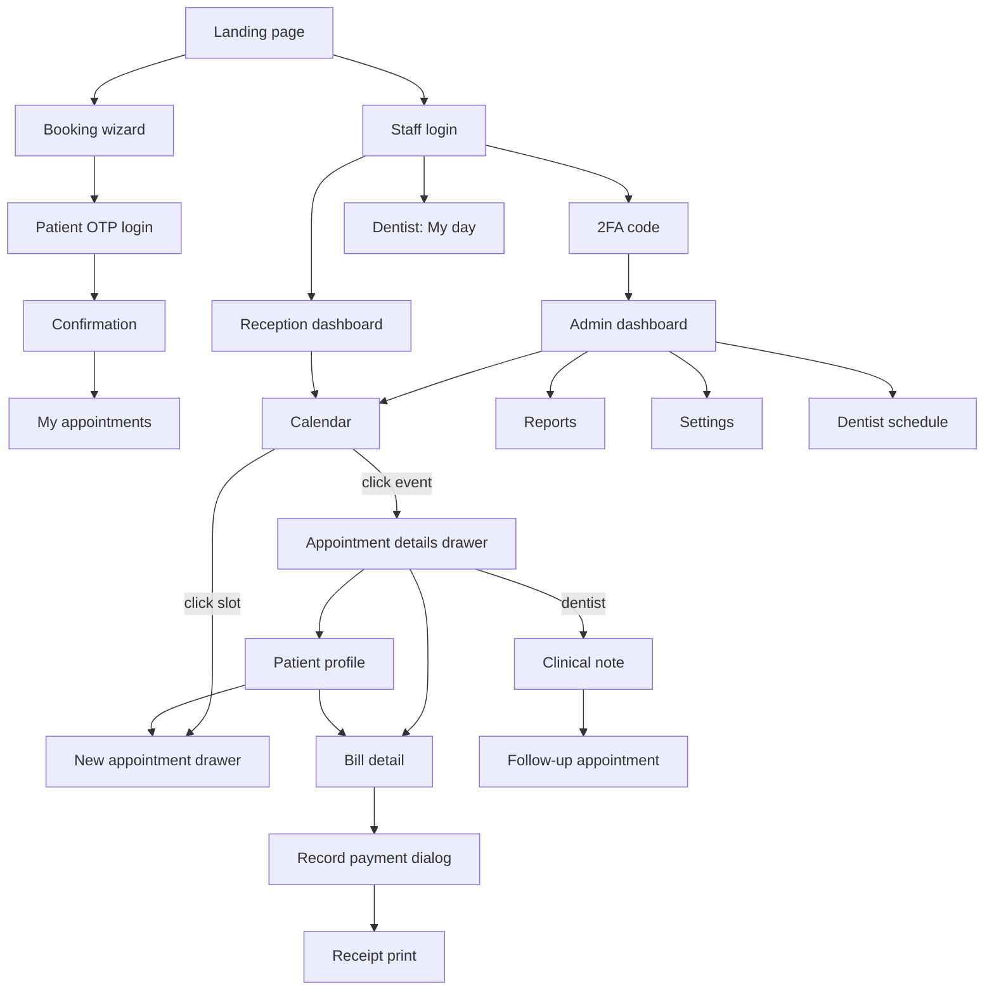

# Dental Clinic MVP — UI/UX Design Specification

> **Status:** DRAFT v0.1 — awaiting approval · **Date:** 2026-11-23
> Based on [01-requirements.md](01-requirements.md), [02-architecture-and-plan.md](02-architecture-and-plan.md), [04-api-spec.md](04-api-spec.md).
> **Arabic-first:** every layout below is described in *logical* directions — **start** = right in Arabic / left in English, **end** = left in Arabic / right in English.

---

## Part A — Design System

### A1. Design principles

| Principle | What it means on screen |
|---|---|
| **Calm & trustworthy** | White surfaces, one teal brand colour, generous spacing, no visual noise. Healthcare users must feel the data is safe. |
| **Today first** | Every staff landing page answers "what's happening now?" before anything else. |
| **Status at a glance** | Appointment status always shown with **colour + icon + text**, never colour alone. |
| **Arabic is native, not translated** | Layouts are designed in RTL first and mirrored for English; Arabic text gets extra line height. |
| **One primary action per screen** | Only one filled teal button per view; everything else is secondary or ghost. |
| **Safe by default** | Destructive actions need a confirmation dialog; restricted data is *hidden*, not shown disabled. |

### A2. Colour palette

All text/background pairs below meet **WCAG 2.1 AA (≥ 4.5 : 1)** unless marked "non-text".

**Brand & neutrals**

| Token | Hex | Use |
|---|---|---|
| `primary-600` | `#0D7C8C` | Primary buttons, active nav item, links, focus ring (4.9 : 1 on white) |
| `primary-700` | `#0A6370` | Primary hover / pressed |
| `primary-100` | `#C5EAEF` | Selected chips, active nav background |
| `primary-50` | `#E7F6F8` | Subtle highlights, selected table row |
| `navy-900` | `#0F2A43` | Sidebar background, page titles |
| `text-primary` | `#0F1E2E` | Body text |
| `text-secondary` | `#52637A` | Labels, secondary text (6.1 : 1) |
| `text-placeholder` | `#64748B` | Placeholders, hints (4.75 : 1) |
| `border` | `#E3E8EE` | Card and input borders (non-text) |
| `surface` | `#FFFFFF` | Cards, dialogs, inputs |
| `background` | `#F7F9FB` | App background |
| `disabled` | `#8A99AD` | Disabled icons only (non-text) |

**Semantic**

| Token | Text / icon | Tint background | Use |
|---|---|---|---|
| `success` | `#15803D` | `#F0FDF4` | Saved, paid, completed |
| `warning` | `#B45309` | `#FFFBEB` | Pending approval, possible duplicate, simulated mode |
| `danger` | `#B91C1C` | `#FEF2F2` | Errors, allergies, outstanding balance, destructive buttons (`#DC2626` button fill) |
| `info` | `#1D4ED8` | `#EFF6FF` | Informational banners |

**Appointment status** (used identically in badges, calendar cards, charts)

| Status | Label (AR / EN) | Colour (text, icon, card bar) | Tint | Icon (Lucide) |
|---|---|---|---|---|
| Booked | محجوز / Booked | `#1D4ED8` | `#EFF6FF` | `calendar-check` |
| Checked-in | حضر / Checked-in | `#B45309` | `#FFFBEB` | `user-check` |
| In Treatment | قيد العلاج / In Treatment | `#6D28D9` | `#F5F3FF` | `activity` |
| Completed | مكتمل / Completed | `#15803D` | `#F0FDF4` | `circle-check` |
| Cancelled | ملغي / Cancelled | `#475569` | `#F1F5F9` | `circle-x` (card at 60% opacity, time struck through) |
| No-show | لم يحضر / No-show | `#B91C1C` | `#FEF2F2` | `user-x` |
| Override (marker) | تجاوز / Override | dashed `#DC2626` border | — | `triangle-alert` |

**Calendar background patterns:** non-working time `#F1F5F9` solid · break `#F1F5F9` with diagonal stripes · leave/block `#E2E8F0` stripes + label · emergency reserve `#FFF1F2` stripes + "طوارئ / Emergency" label · current-time line `#DC2626` 2 px.

**Chart palette** (categorical, colour-blind-safe order): `#0D7C8C`, `#1D4ED8`, `#B45309`, `#6D28D9`, `#15803D`, `#BE185D`, `#475569`. Status charts always use the status colours above.

*Dark mode:* not in MVP; colours are defined as tokens so it can be added later.

### A3. Typography

| Item | Decision |
|---|---|
| Font family | **IBM Plex Sans Arabic** (Google Fonts) for **both** languages — it includes matching Latin letters, so Arabic and English look like one family. Fallback: `Tahoma, system-ui, sans-serif`. |
| Weights | 400 Regular (body), 500 Medium (labels, buttons), 600 SemiBold (headings, numbers), 700 Bold (KPI numbers only) |
| Digits | Western digits (0–9) in both languages **[Q-26]**; `tabular-nums` in tables, times, money so columns align |
| Line height | Arabic 1.7 · English 1.5 |

| Style | Size / line height | Weight | Use |
|---|---|---|---|
| Display | 30 / 38 | 700 | KPI numbers |
| H1 | 24 / 32 | 600 | Page title |
| H2 | 20 / 28 | 600 | Section / card titles |
| H3 | 16 / 24 | 600 | Sub-sections, dialog titles |
| Body | 14 / 22 (staff) · 16 / 26 (patient portal) | 400 | Text |
| Label | 13 / 20 | 500 | Form labels, table headers |
| Caption | 12 / 16 | 400 | Hints, timestamps |

**Formats:** date `الثلاثاء، 1 ديسمبر 2026` / `Tue, 1 Dec 2026` · time `10:30 ص` / `10:30 AM` · money `150.00 ر.س` / `SAR 150.00` · mobile always shown LTR `+966 5X XXX XXXX`, even inside Arabic text.

### A4. Spacing, shape, elevation, icons

- **Spacing:** 4 px grid → 4, 8, 12, 16, 24, 32, 48. Page padding 24 (desktop) / 16 (mobile). Card padding 20.
- **Radius:** inputs & buttons 8 px · cards & dialogs 12 px · badges full-pill.
- **Elevation:** cards `0 1px 2px rgba(15,30,46,.06)`; dialogs/drawers `0 12px 32px rgba(15,30,46,.16)`. No heavy shadows.
- **Icons:** Lucide, 20 px (16 px in dense tables), stroke 1.75. Directional icons (arrows, chevrons, "back") mirror in RTL; clocks, phone, checkmarks, play icons do **not** mirror.
- **Touch targets:** minimum 44 × 44 px on tablet/mobile.

### A5. Breakpoints

| Name | Width | Shell behaviour |
|---|---|---|
| Mobile | < 640 px | No sidebar; top bar + bottom tab bar; drawers become full-screen sheets |
| Tablet | 640–1023 px | Sidebar collapsed to 72 px icons (tooltips on hover/long-press); drawers 80% width |
| Desktop | 1024–1439 px | Sidebar 256 px expanded (user can collapse) |
| Wide | ≥ 1440 px | Content max-width 1440 px centred; calendar uses full width |

### A6. Application shell (staff)

```
Arabic (RTL)                                                     
┌──────────────────────────────────────────────────┬────────────┐
│ Header 64px: [≡] Page title / breadcrumb          │            │
│  [🔍 Search patients…  Ctrl+K]  [+ موعد جديد] [🔔3] [EN] [👤]│  Sidebar   │
├──────────────────────────────────────────────────┤  256px     │
│                                                  │  navy-900  │
│   Main content (background #F7F9FB)              │  logo      │
│                                                  │  nav items │
│                                                  │  …         │
│                                                  │  user card │
└──────────────────────────────────────────────────┴────────────┘
(English mirrors: sidebar on the left)
```

- **Sidebar** (start side, `navy-900`, white 80% text; active item: `primary-600` bar on the start edge + white text + `rgba(255,255,255,.08)` background). Items depend on role:

| Admin | Receptionist | Dentist | Assistant |
|---|---|---|---|
| Dashboard · Calendar · Appointments · Patients · Dentists · Schedules · Payments · Reports · Notifications · Audit logs · Settings | Today (reception dashboard) · Calendar · Appointments · Patients · Payments · Schedules | My day · My schedule · My patients | Today · Schedule |

- **Header:** page title + breadcrumb; global patient search (name / mobile / file no; `Ctrl+K`), hidden for dentist/assistant; **"+ New appointment"** primary button (Admin, Receptionist); alerts bell with unread count (opens a popover list; "Mark all read"); language toggle `EN` / `ع`; user menu (profile, 2FA setup, sign out).
- **Mobile shell:** top bar (menu ≡, title, bell); bottom tab bar with 4 items per role, e.g. Receptionist: Today · Calendar · Patients · More; floating "+" button (start-bottom corner, above the tab bar) for new appointment.
- **Toasts:** bottom, end side (bottom-left in Arabic); success auto-hides after 4 s, errors stay until dismissed; announced to screen readers.
- **Session timeout:** 2 minutes before the 30-minute idle limit, a dialog appears: "You'll be signed out soon" [Stay signed in].

### A7. Shared components & patterns

| Component | Specification |
|---|---|
| **Buttons** | Primary (teal fill), Secondary (white + border), Ghost (text only), Destructive (red fill, only inside confirm dialogs). Height 40 (desktop) / 44 (touch). Loading = spinner replaces icon, label stays, button disabled. |
| **Status badge** | Pill: tint background, coloured icon + text (see A2). Sizes sm (tables) / md (headers). |
| **Tables** | Sticky header, sortable columns (arrow icon), zebra off, row hover `primary-50`, row click opens detail, row actions in a `⋯` menu at the end, pagination 25 rows ("1–25 of 134"), numbers end-aligned. On mobile each row becomes a card. |
| **Filter bar** | Above tables: search box + filter buttons (popover multi-selects) + date-range picker; active filters show as removable chips + "Clear all". Filters are kept in the URL so links can be shared and refresh keeps them. |
| **Forms** | Label above field, `*` for required, hint text below, error text in `danger` below field with icon, validate on blur and on submit; server errors mapped to fields; first error field focused on submit. Mobile field `+966` prefix fixed and LTR. Dates via date picker (week starts **Sunday**). |
| **Dialog (modal)** | Max 520 px; title, body, footer actions at the end side (primary last). Focus trapped; `Esc` closes unless data was entered (then "Discard changes?"). Destructive confirmations need a **reason** field when the requirement says so. |
| **Drawer (side sheet)** | Slides from the **end** side, 480–560 px; used for details and quick forms without leaving the page. Full-screen on mobile. |
| **Empty state** | Centred icon (48 px, `primary-100` circle), title, one sentence, one action. E.g. "No appointments today · [+ New appointment]". |
| **Loading state** | Skeleton blocks shaped like the final content (cards, rows, calendar grid); never a blank page. Buttons show spinners. |
| **Error state** | Inline card: icon, "Something went wrong", plain explanation, [Try again], small reference code (correlation id) for support. 403 → "You don't have access to this page" + back to home. 404 → "Not found". |
| **Restricted data** | Sections the user can't access are **not rendered** (no lock teaser). Where context needs it (e.g. receptionist on appointment drawer), show "Clinical details are restricted" in muted text. |
| **Allergy flag** | Red tint banner with `triangle-alert` icon: "حساسية: بنسلين / Allergy: Penicillin" — shown only to clinical roles. |
| **Simulated-mode banner** | Thin `warning` strip at the top of the staff app and on OTP screens in development: "Simulated mode — messages are not really sent. OTP: 123456". |

### A8. Navigation map



---

## Part B — Screens

Each screen covers: **1 Purpose & primary action · 2 Layout · 3 Components · 4 Navigation · 5 Colour & type notes · 6 Responsive.**

---

### S1. Login (Staff login · 2FA · Patient OTP)

**1. Purpose & primary action**
- *Staff:* sign in securely → **"تسجيل الدخول / Sign in"**. Admins must complete 2FA.
- *Patient:* identify by mobile + one-time code → **"إرسال الرمز / Send code"** then **"تأكيد / Verify"**.

**2. Layout**
- No sidebar or app header. Top strip: clinic logo (start), language toggle (end).
- **Desktop:** split 50/50 — *form panel* on the start side (white, form card max 400 px, vertically centred); *brand panel* on the end side (`primary-600` → `navy-900` gradient, soft tooth/smile line illustration, clinic name, one-line tagline "رعاية أسنانك تبدأ بموعد سهل").
- Form card order (staff): title "مرحبًا بعودتك / Welcome back", subtitle "Staff sign-in", email, password, "Forgot password?" link (end-aligned), Sign in button (full width), footer link "Are you a patient? Book an appointment".

**3. Components**
- Email input (`autocomplete=username`, LTR), password input with show/hide eye toggle (`autocomplete=current-password`).
- Error banner (danger tint) above fields: always generic "Email or password is incorrect" (never reveals which). 429 → "Too many attempts. Try again in 15 minutes." Inactive → "Your account is inactive. Contact the clinic administrator."
- **2FA step** (same card, replaces fields): "Enter the 6-digit code from your authenticator app", 6 separate boxes (auto-advance, paste whole code, auto-submit on 6th digit), "Use a different account" link.
- **2FA enrollment** (Admin without 2FA, forced on first login): step 1 QR code + copyable secret + list of recommended apps; step 2 enter code to confirm; success → continue.
- **Forgot password:** email field → neutral message "If this email exists, a reset link has been sent".
- **Patient OTP** (separate route, also embedded as step 5 of the booking wizard): mobile field with fixed `+966` prefix (`inputmode=tel`), "Send code"; then 6-box code input (`autocomplete=one-time-code`, `inputmode=numeric`), resend link with 60 s countdown ("Resend in 0:42"), "Change number" link; errors: wrong code (attempts left), expired, locked 15 min. Simulated-mode banner shows the test code in development.

**4. Navigation**
- *In:* landing footer "Staff login"; any protected URL when signed out (returns there after login via `returnTo`); session expiry ("You were signed out for your security").
- *Out (by role):* Admin → Admin dashboard · Receptionist → Reception dashboard · Dentist → My day · Assistant → Today · Patient → previous booking step or My appointments · New patient after OTP → short registration form (name, DOB, gender, email, privacy consent) → continue.

**5. Colour & type notes** — form panel white on `background`; single primary button; brand panel is the only place gradients are used in the whole product.

**6. Responsive**
- *Tablet:* brand panel becomes a 160 px band on top; form below, centred.
- *Mobile:* brand panel hidden; logo above form; full-width inputs 48 px high; buttons fixed to the bottom of the viewport above the keyboard area for OTP screens.

---

### S2. Admin Dashboard

**1. Purpose & primary action** — show clinic health for today / this week / this month and route the admin to what needs attention. Primary: **"+ New appointment"** (header); main use is *clicking through* to details.

**2. Layout** (desktop 12-column grid, 24 px gaps)

```
┌ Title "لوحة التحكم" · date ───────────────── [اليوم | هذا الأسبوع | هذا الشهر] ┐
│ Row 1  KPI ×4 : Appointments today │ Completed │ Cancelled │ No-show          │
│ Row 2  KPI ×4 : Patients total │ New patients │ Revenue │ Outstanding           │
│ Row 3  Today's schedule (8 cols)           │ Needs attention (4 cols)          │
│ Row 4  Appointments trend chart (6)        │ Dentist utilization (6)           │
│ Row 5  Revenue chart (8)                   │ Upcoming next 7 days (4)          │
└────────────────────────────────────────────────────────────────────────────────┘
```

**3. Components**
- **Period segmented control** (Today / This week / This month) — changes all widgets; kept in URL.
- **KPI card:** label (Label style, `text-secondary`), value (Display, tabular), comparison chip vs previous period ("▲ 12%"); colour depends on meaning — more completed = green, more cancellations/no-shows = red. "Appointments today" card also shows a mini stacked bar by status. Cards are clickable (hover lift + pointer) → filtered report.
- **Today's schedule widget:** compact list ordered by time: time, patient name, service dot + name, dentist avatar, status badge; max 8 rows + "Open calendar →". Empty state: "No appointments today".
- **Needs attention widget:** rows with icon, label, count pill, chevron: Pending discount approvals · Refund requests · Possible duplicate patients · Failed notifications · Appointments overridden today. Hidden rows when count = 0; all-clear empty state "Nothing needs your attention ✓".
- **Appointments trend:** stacked column chart by status per day (week/month) or per hour (today); legend under chart; tooltip with exact numbers.
- **Dentist utilization:** horizontal bars per dentist (avatar + name), % booked of scheduled minutes, label at bar end; bars ≥ 85% `warning`, < 40% `text-secondary`.
- **Revenue chart:** line (collected) + light columns (billed); tooltip SAR values; total in card header.
- **Upcoming next 7 days:** list day → count chips per status.
- Skeletons per widget while loading; each widget fails independently with its own retry.

**4. Navigation**
- *In:* Admin login landing; sidebar "Dashboard"; logo click.
- *Out:* KPI → Reports (pre-filtered) · schedule row → Appointment details drawer · "Open calendar" → Calendar (day) · attention rows → Approvals tab / Duplicates review / Notification log / Calendar filtered to overrides · utilization bar → that dentist's Schedule · chart bar click → Reports filtered to that day.

**5. Colour & type notes** — white cards on `background`; KPI numbers `text-primary` 700; status colours only in status visuals; charts use the chart palette.

**6. Responsive**
- *Tablet:* KPIs 2 per row (4 rows); Today's schedule and Needs attention full width, stacked; charts full width.
- *Mobile:* period control full width; **Needs attention first**, then KPIs as a 2-column compact grid (value + label only), then today's schedule (6 rows), charts simplified (no legend, tap for tooltip), upcoming list last.

---

### S3. Appointment Calendar

**1. Purpose & primary action** — see and manage the clinic schedule by dentist or chair; create, move, and change status of appointments. Primary: **create** (click empty slot or "+ New appointment") and **move** (drag).

**2. Layout**
- **Toolbar** (one row, wraps on smaller screens): `Today` button · prev / next arrows (mirrored in RTL) · date title ("الثلاثاء، 1 ديسمبر 2026" / week range / month) with date-picker popover · view switch `Day | Week | Month | Agenda` · resource switch `By dentist | By chair` · `Filters` button with count badge · legend `ⓘ` popover · (end side) "+ New appointment".
- **Day view – by dentist:** sticky header row of columns, one per dentist: avatar, name, "8 appointments"; sticky time column on the start side with hour labels; 15-minute grid lines (hour lines darker). Visible hours = earliest clinic opening to latest closing. *By chair:* same with chair names.
- **Week view:** columns = days (Sun → Sat; Friday shaded if closed) for **one** selected dentist or chair (selector in toolbar); same time grid.
- **Month view:** 7-column grid; each day cell shows date number and up to 3 status count chips ("5 محجوز", "2 مكتمل") + "+N"; closed days shaded; today ringed in `primary-600`.
- **Agenda view:** list grouped by time, used as the default on mobile.
- **Appointment details drawer** (end side, 480 px) — opened by clicking an event.

**3. Components**
- **Event card:** white card, 4 px bar on the start edge in **status colour**, status icon top-end; content by height: time range (caption, tabular) · patient name (500) · service (dot in service colour + name). 20-minute events show patient name only. Cancelled at 60% opacity with struck time (hidden unless "Show cancelled" filter on). Allergy `⚠` icon for clinical roles. Override events: dashed red border + `triangle-alert`. Walk-in / Emergency: small tag ("Walk-in", red "Emergency").
- **Hover tooltip** (desktop): full details + phone (masked for non-reception).
- **Filters popover:** dentists (multi), chairs (multi), services (multi), statuses (multi), "Show cancelled" switch, "Clear".
- **Details drawer:** header — reference no, status badge, `⋯` menu; patient block — name (link), file no, age, mobile, no-show count, allergy flag (clinical roles); visit block — service, duration, price, dentist, chair, date/time, channel, front-desk note (editable inline for reception); **status action bar** with only the allowed next steps for this user (e.g. Booked → `Check in` primary, `No-show`, `Cancel`); secondary actions: `Reschedule`, `Reassign`, `Open patient`, `Open bill`, `Add clinical note` (dentist), `Create follow-up` (dentist); footer: status history timeline (who / when / reason).
- **Cancel dialog:** reason (required for staff) + "Notify patient" checkbox (default on) → destructive confirm.
- **Drag & drop** (Admin, Receptionist only; desktop/tablet): while dragging, the target shows a green outline if free or red with "not-allowed" cursor and a tooltip reason ("Dr. Sara is on leave", "Chair 2 busy") using cached availability; drop → confirm dialog "Move A-000457 from 10:00 Dr. Sara → 11:00 Dr. Omar · ☑ Notify patient" [Move]. Resize bottom edge to extend duration (same confirm). Server conflict (409) → event snaps back + error toast + calendar refresh.
- **Click empty slot** → New appointment drawer pre-filled with date, time, dentist or chair.
- **Auto refresh:** every 60 s and when the browser tab regains focus; small "Updated just now" caption in toolbar.

**4. Navigation**
- *In:* sidebar "Calendar"; dashboard "Open calendar"; patient profile appointment row ("Show in calendar"); attention rows (overrides).
- *Out:* drawer → Patient profile · Bill detail · New appointment (follow-up) · Clinical note (dentist). Month day click → Day view of that date. Week column header click → Day view.
- *Role behaviour:* Dentist — default view own column, Week view own; drag disabled; status actions limited (In Treatment, Completed, No-show). Assistant — linked dentists only; only "Start treatment".

**5. Colour & type notes** — status colours drive the event bar/icon; service colours appear only as small dots so the two systems never compete. Grid lines `border`; hour labels caption `text-secondary`.

**6. Responsive**
- *Tablet:* Day view shows up to 3 resource columns, horizontal scroll for more with sticky time column; drawer 80% width; drag supported (long-press to pick up).
- *Mobile:* default **Agenda** view with a horizontal date strip (7 day chips, swipe for next week) and a resource chip filter ("All dentists ▾"); Day grid available but single column with dentist selector; drag disabled — use `Reschedule` in the details sheet; details open as full-screen sheet with sticky action bar at the bottom; floating "+" button.

---

### S4. Patient Profile

**1. Purpose & primary action** — one place for everything about a patient. Primary: **"+ Book appointment"**. Clinical staff: review medical info and notes.

**2. Layout**
- **Header card** (becomes a compact sticky bar on scroll): avatar with initials (`primary-100`/`primary-700`), full name (H1), file no chip, age + date of birth, gender, mobile (copy button). Badges row: `Dependent of …` (link), `Possible duplicate` (warning), `No-shows: 2` (danger tint if ≥ 1), `Balance: 107.00 ر.س` (danger tint, Admin/Reception only). Actions on the end side: **Book appointment** (primary), `Edit`, `⋯` (Link family member, Deactivate — Admin).
- **Allergy banner** directly under the header (clinical roles, if any allergies).
- **Tabs:** Overview · Appointments · Medical 🔒 · Clinical notes 🔒 · Billing · Family. Tabs the user can't access are **not shown** at all.

**3. Components (per tab)**
- **Overview:** 2-column cards — *Personal details* (definition list: name, mobile, DOB, gender, email, national ID, preferred language, registered on/by); *Emergency contact*; *Upcoming appointments* (next 3 with status badge + "View all"); *Visit stats* (total visits, last visit date, no-shows, cancellations); *Family* summary chips.
- **Appointments:** table — date/time, service, dentist, status badge, channel, reference no; status filter chips (All, Upcoming, Completed, Cancelled, No-show); row click → Appointment details drawer.
- **Medical** (Admin, Dentist, Receptionist with permission): read view with 4 sections — Allergies, Medical conditions, Current medications, Medical notes — each as text block or "None recorded"; footer "Last updated by Dr. … on …"; info note "Viewing this section is recorded for patient privacy." `Edit` (Admin, Dentist) → same layout as textareas with character counters → Save / Cancel. *Opening the tab triggers the audited read.*
- **Clinical notes** (Admin, Dentist): timeline grouped by appointment, newest first — date, service, dentist name, note text, addenda indented with "Addendum" label; `Edit` shown only for the author within 24 h ("Editable for 3 more hours"); after that `Add addendum`. New notes are added from the appointment drawer (context-linked).
- **Billing** (Admin, Receptionist): 3 summary tiles (Total billed, Paid, Balance) + bills table (bill no, date, service, total, paid, balance, status) → Bill detail.
- **Family:** two lists — *Guardians* and *Dependents* — each row: name, relationship, file no, age, `Open`, `Unlink` (Reception/Admin, confirm dialog). Buttons `+ Add dependent` (mini form) and `Link existing patient` (search combobox + relationship select).
- **Edit patient drawer:** all patient fields (PAT-01); on mobile/DOB change runs duplicate check → inline warning card listing matches ("Open" / "Keep editing").

**4. Navigation**
- *In:* Patients list (search → row); header global search; appointment drawer "Open patient"; after quick registration; family links between profiles.
- *Out:* Book appointment → New appointment drawer pre-filled with patient · appointment row → Details drawer · bill row → Bill detail · family member → their profile.

**5. Colour & type notes** — header card white with subtle bottom border; restricted tabs marked with a small lock icon (meaning "sensitive", for users who *can* see them); allergy banner is the only red element unless balance/no-shows exist.

**6. Responsive**
- *Tablet:* Overview cards single column; tabs horizontally scrollable.
- *Mobile:* compact header (avatar, name, file no; badges wrap); actions move to a **sticky bottom bar** (`Book appointment` primary + `More` sheet); tabs become scrollable chips; tables become cards (date + status on top line, service/dentist below).

---

### S5. New Appointment Form (staff)

**1. Purpose & primary action** — book a phone, desk, walk-in, or emergency appointment in under a minute. Primary: **"حجز الموعد / Book appointment"**.

**2. Layout** — **drawer** from the end side (560 px) so the calendar stays visible; one scrolling form in 4 numbered sections + a live summary + a sticky footer.

```
┌ New appointment                                  ✕ ┐
│ 1 Patient       [search…………………][+ New patient] │
│ 2 Visit type    (Phone/Desk | Walk-in | Emergency)  │
│                 Service [select ▾]                  │
│ 3 Dentist & time  Dentist [Any available ▾]         │
│                 Date [📅 1 Dec 2026]  Chair [auto ▾]│
│                 Morning: [09:00][09:15][09:45]…     │
│                 Evening: [16:00][16:30]…            │
│ 4 Notes         [front-desk note……]  ☑ Check in now │
│ ── Summary card ──────────────────────────────────  │
├─────────────────────────────────────────────────────┤
│ [Cancel]                        [Book appointment]  │
└─────────────────────────────────────────────────────┘
```

**3. Components**
- **Patient combobox:** type ≥ 2 chars (name / mobile / file no) → results show name, file no, masked mobile, DOB; keyboard navigable. Selected patient shows as a chip with hints: allergy icon (clinical roles), "2 no-shows", "Balance 107 ر.س".
- **+ New patient** expands an inline mini form: full name*, mobile* (`+966`), date of birth*, gender. On DOB blur → duplicate check; if matches: warning card listing them with `Use this patient` buttons, or `Create anyway` (record is flagged for review). If age < 18: optional "Link to guardian" combobox.
- **Visit type** segmented control: Phone/Desk (default) · Walk-in · Emergency (red-tinted when selected; auto-selects service "Emergency Visit" and shows reserved emergency times first).
- **Service select:** name + "45 min · 200.00 ر.س" on each option.
- **Dentist select:** "Any available" first, then dentists with avatars; unavailable-today dentists shown greyed with reason ("On leave").
- **Date picker:** days with no availability greyed; quick chips `Today` `Tomorrow`.
- **Time slot chips:** grouped by shift (Morning / Evening), 4–6 per row; with "Any" each chip shows a tiny initials badge of the first free dentist; selected chip `primary-600` filled; walk-in shows a leading chip **"Now · 17:00"** (next free). Empty: "No times on this day — next available: Wed 3 Dec [Go]".
- **Chair select:** auto-filled (preferred chair); lists only chairs free for the chosen time.
- **Admin override** (Admin only): switch "Book even if the time is taken" → warning banner explaining the double booking, required **reason** textarea, and a free time input replaces slot chips.
- **Front-desk note:** textarea, 500-character counter. **Check in now** checkbox (shown and pre-checked for walk-in).
- **Summary card:** patient, service, dentist, chair, date, start–end, price — updates live.
- **Footer:** `Cancel` (ghost; confirms discard if data entered) + `Book appointment` (disabled until valid; spinner while saving).
- **Errors:** field errors inline; server 409 → red banner at the top of the drawer "This time was just taken" + slot list refreshes and scrolls into view; 422 (e.g. outside working hours) → banner with the reason.
- **Follow-up mode** (from dentist): title "Follow-up appointment", patient + dentist locked, service defaults to Follow-up, shows link "Follow-up of A-000457".

**4. Navigation**
- *In:* header "+ New appointment" · calendar empty-slot click (pre-filled) · patient profile "Book appointment" (patient pre-filled) · appointment drawer "Create follow-up" · reception dashboard "Walk-in" quick button (visit type pre-set).
- *Out:* success → drawer closes, toast "Appointment A-000457 booked · View", calendar highlights the new event for 3 s; if checked in → reception queue updates. Cancel → back to where it was opened.

**5. Colour & type notes** — section numbers in `primary-600` circles; emergency is the only red-styled selectable; summary card on `primary-50`.

**6. Responsive**
- *Tablet:* drawer 80% width.
- *Mobile:* full-screen page; sections as accordion steps (completed sections collapse to a one-line summary); slot chips 3 per row, 44 px tall; sticky footer with the primary button full-width.

---

### S6. Dentist (Doctor) Schedule

**1. Purpose & primary action** — define when each dentist works, which chairs they use, and manage leave/blocks. Primary: **"Save weekly hours"** / **"+ Add leave or block"**. Dentist role: view own schedule.

**2. Layout**
- Page header: **dentist selector** (avatar + name dropdown; Admin/Reception) · tabs: **Weekly hours · Leave & blocks · Week preview**.
- *Weekly hours* tab: two columns on desktop — **weekly grid** (8 cols) and **Assigned chairs** card (4 cols).
- Sticky **unsaved-changes bar** at the bottom when edits exist: "You have unsaved changes" [Discard] [Save].

**3. Components**
- **Weekly grid:** 7 rows Sunday → Saturday. Each row: day name · "Working" switch · shift chips ("09:00 – 13:00" with ✎ and ✕) · `+ Add shift`. Gaps between shifts appear automatically as muted text "Break 13:00 – 16:00". Clinic opening hours drawn as a faint reference bar behind each row; a shift outside clinic hours shows a warning icon + tooltip. Overlapping shifts → inline error. Helper button "Copy Sunday's hours to Mon–Thu".
- **Shift editor popover:** start / end time pickers (15-minute steps), Save.
- **Date-specific schedule** (e.g. Ramadan): `+ Add date-specific hours` → card with date range and its own 7-row grid; listed above the default grid with a "Ramadan 1448: 1 Mar – 30 Mar" label and Edit/Delete.
- **Assigned chairs card:** checkbox per chair + "Preferred" radio; note "Online bookings use the preferred chair first".
- **Save result:** if existing appointments fall outside the new hours → dialog "4 appointments are outside the new hours" with list (date, time, patient, ref) and `Review` links (open Appointment drawer) — hours are saved; the list stays available as a banner until handled.
- **Leave & blocks tab:** `+ Add leave or block` button; table — type badge (Leave `info`, Block `text-secondary`, Emergency reserve `danger` tint), from–to, all-day indicator, reason, created by, actions (`Edit`, `Delete` with confirm). Filter: upcoming / past.
- **Add leave/block dialog (2 steps):** Step 1 — type, all-day switch, date range, time range (if not all-day), reason. Step 2 (only if conflicts) — "3 appointments affected": each row with `Reschedule`, `Reassign` (opens appointment editor in place), checkbox "Notify patients" (default on) → `Confirm block`.
- **Week preview tab:** the calendar Week view for this dentist (read-only) showing shifts, breaks, blocks, and appointments.
- **Dentist role ("My schedule"):** Week preview + read-only summary of weekly hours and upcoming leave; no edit controls.

**4. Navigation**
- *In:* sidebar "Schedules" (Admin, Reception) · Dentists list → dentist → "Schedule" tab · dashboard utilization bar · dentist sidebar "My schedule".
- *Out:* affected appointment → Appointment details drawer / reschedule editor · Week preview event → details drawer · dentist selector switches context without leaving the page (unsaved-changes guard).

**5. Colour & type notes** — shift chips `primary-50` with `primary-700` text; breaks muted; leave/blocks use the calendar stripe patterns so the preview matches the main calendar.

**6. Responsive**
- *Tablet:* chairs card moves below the grid.
- *Mobile:* each weekday becomes a collapsible card (summary line "09:00–13:00, 16:00–21:00"); native time pickers; leave table becomes cards; Week preview becomes Agenda list.

---

### S7. Billing — Bills, Payments & Receipts

> Naming: the MVP issues **Bills** and **Receipts (إيصال)**, not "tax invoices" (see risk R-5, ZATCA).

**1. Purpose & primary action** — find bills with a balance, collect payments, apply discounts, handle refunds, print receipts. Primary: **"تسجيل دفعة / Record payment"**.

**2. Layout**
- **Bills list page:** header tabs `Unpaid & partial` (default) · `Paid` · `All` · `Approvals (3)` (Admin only, count badge). Summary strip of 4 tiles for the selected date range: Billed · Collected · Refunded · Outstanding. Filter bar: date range, patient search, dentist, status. Table below.
- **Bill detail page:** header (bill no, status badge, patient link, appointment ref link, date) · main area two columns — *lines & totals* (8 cols) and *payments & refunds* (4 cols).

**3. Components**
- **Bills table:** bill no · date · patient · service(s) · total · paid · **balance** (600 weight, `danger` if > 0) · status badge (Unpaid `danger` tint, Partially paid `warning`, Paid `success`, Void grey) · row actions: `Record payment` (if balance > 0), `View`.
- **Lines table** (detail): service/description, qty, unit price, line total; `+ Add line` (service select or custom description + price) and remove icons — available only while no payments exist (otherwise a lock note "Lines are locked after payment; use a refund to correct").
- **Totals block** (end-aligned, tabular): Subtotal · Discount (with `Pending approval` badge if pending, not deducted yet) · VAT 15% · **Total** · Paid · Refunded · **Balance** (H2, `danger` if > 0, `success` "Paid in full" if 0).
- **Actions bar:** `Record payment` (primary) · `Apply discount` · `Request refund` (Reception) / `Refund` (Admin) · `⋯` → Void payment (Admin).
- **Payments list:** receipt no, date/time, method icon + name, amount, received by; `🖨 Print receipt`; voided payments struck through with "Voided: reason".
- **Refunds list:** refund no, amount, method, status badge (Requested `warning`, Approved `success`, Rejected grey), reason.
- **Record payment dialog:** amount (pre-filled with balance; `Full balance` quick button; max = balance) · method as 3 radio cards with icons (Cash `banknote`, Card `credit-card`, Bank transfer `landmark`) · reference field shown for card/transfer ("Last 4 digits" / "Transfer reference") · live line "Remaining after this payment: 107.00 ر.س" · `Record payment`. Success state inside the dialog: ✓ "Payment recorded — Receipt R-000790" [Print receipt] [Done]. A unique request key is created when the dialog opens so a double-click can't record twice.
- **Discount dialog:** Percent / Fixed toggle, value, reason*, live preview of new total. If above the receptionist limit: warning banner "Above your 10% limit — this will be sent to an administrator for approval"; button label changes to `Send for approval`.
- **Refund dialog:** amount (max = refundable), method, linked payment (optional select), reason*; Reception button `Request refund`, Admin `Refund now`.
- **Approvals tab (Admin):** cards — type (Discount / Refund), bill + patient, amount or %, requested by/at, reason; `Approve` (primary) / `Reject` (requires reason).
- **Void payment dialog (Admin):** reason* + destructive confirm.
- **Receipt print view:** A5 portrait, print-only layout (app shell hidden): clinic logo, names AR/EN, address, phone, VAT number (if set); title **"إيصال / Receipt"**; receipt no, date/time, patient name + file no, bill no; lines table; discount, VAT, total, this payment (method), total paid, remaining balance; footer "This is a payment receipt, not a tax invoice." Language follows the UI language with bilingual title. Buttons on screen: `Print` / `Close` ("Save as PDF" via the browser print dialog).

**4. Navigation**
- *In:* sidebar "Payments" · appointment drawer `Open bill` (creates the bill if missing) · patient profile Billing tab · dashboard Outstanding KPI & attention rows · reception dashboard `Collect` buttons.
- *Out:* patient link → Patient profile · appointment link → Appointment drawer on Calendar · Print → Receipt view → back to bill.

**5. Colour & type notes** — money always tabular, end-aligned; balance is the single strongest element on the bill; method icons in `text-secondary`.

**6. Responsive**
- *Tablet:* detail page stacks payments/refunds under totals.
- *Mobile:* list rows become cards (patient + balance on top, status + date below); bill detail single column with a **sticky bottom `Record payment` button**; dialogs as full-screen sheets; receipt printing is a desktop task, mobile shows "Open receipt" (browser share/save as PDF).

---

### S8. Settings (Admin)

**1. Purpose & primary action** — configure how the clinic runs. Primary: **"حفظ التغييرات / Save changes"** per section.

**2. Layout** — inside the app shell: a **secondary navigation list** (start side, 220 px) + **content panel** (max 800 px). Sections:
1. Clinic profile
2. Working hours & holidays
3. Booking rules
4. Billing & VAT
5. Notifications
6. Staff & permissions
7. Services
8. Chairs

Each section is its own form with a sticky unsaved-changes bar; navigating away with unsaved changes prompts "Discard changes?". Caption at the bottom of each section: "Changes are recorded in the audit log."

**3. Components (per section)**
- **Clinic profile:** names AR/EN, legal name, logo upload (drag-and-drop zone, preview, png/jpg/svg ≤ 1 MB), address AR/EN, phone, WhatsApp, email.
- **Working hours & holidays:** same weekly grid component as S6 (clinic-level) + date-specific hours; holidays table (name, from–to, `Edit`/`Delete`) and `+ Add holiday` dialog; if a holiday overlaps bookings → affected appointments list (same pattern as S6).
- **Booking rules:** number inputs with units and plain-language helper text under each: "Online bookings at least **2** hours ahead", "Up to **90** days ahead", "Patients can cancel/reschedule online up to **24** hours before", slot interval select (5/10/15/20/30 min), buffer minutes, "Max **3** upcoming online bookings per patient", "Suggest no-show after **15** minutes". Preview sentence updates live: "A patient visiting now can book from 18:15 today until 21 Feb 2027."
- **Billing & VAT:** VAT switch, rate (%), VAT registration no (15 digits, validated), "Prices include VAT" switch, receptionist discount limit (%), info banner (info tint): "Receipts are not ZATCA e-invoices. E-invoicing must be implemented before production billing."
- **Notifications:** provider status card — `warning` tint "Simulated mode: messages are logged, not sent" (later: "WhatsApp connected ✓"); preferred channel radio (WhatsApp / SMS / Email — unavailable ones disabled with "Not configured"); switches for 24 h and 2 h reminders; read-only template preview with AR/EN toggle and sample data.
- **Staff & permissions:** table (name, email, role badge, status, 2FA ✓/✗, last login, `⋯`) + `+ Add staff member` dialog (names AR/EN, email, phone, role, temporary password with generator, link to dentist profile if role = dentist). Row click → drawer: role select, linked dentist, **permission switches** with one-line explanations ("View medical info — allows this receptionist to open the Medical tab"), `Reset password`, `Deactivate` (confirm + reason; disabled for the last active admin with tooltip).
- **Services:** table — colour dot, name AR/EN, duration, price, "Online" switch, "Active" switch, `Edit`; `+ Add service` dialog (code, names, duration, price, colour swatches, online bookable, active). Note under table: "Price/duration changes don't affect existing appointments."
- **Chairs:** cards per chair — name AR/EN, assigned dentists (avatars), Active switch, `Edit`; `+ Add chair`.

**4. Navigation**
- *In:* sidebar "Settings" (Admin only) · user menu → Settings · dashboard attention "Failed notifications" → Notifications section.
- *Out:* section nav switches sections (URL per section, e.g. `/ar/settings/booking-rules`); staff row → staff drawer; dentist link in chairs → Dentist page.

**5. Colour & type notes** — helper texts in `text-secondary` caption; numbers in rules shown bold inside sentences so non-technical admins understand the effect.

**6. Responsive**
- *Tablet:* section nav becomes a horizontal scrollable tab row above the content.
- *Mobile:* Settings home is a list of sections (icon + name + one-line description) → tap opens section page with back arrow; forms single column; sticky full-width Save.

---

## Part C — Other MVP Screens (summary; detailed spec written in their build phase)

| Screen | Purpose | Key layout / components |
|---|---|---|
| **Landing page** (public) | Introduce clinic, drive bookings | Hero with "احجز موعدك / Book now" CTA, services cards with "from" price, dentists cards, hours & map link, contact/WhatsApp, footer with staff login link |
| **Booking wizard** (public) | Patient books in 7 steps | Progress bar "Step 2 of 7"; service cards → dentist cards ("Any available" first) → date (week strip + month calendar, available days marked) → time chips (Morning/Evening) → OTP login → "Who is this for?" (self / dependents / + add) → review & confirm (policy note: "Free cancellation up to 24 h before") → confirmation (large reference no, details, "Manage my appointments"). Sticky bottom bar with selection summary + Continue; Back keeps choices; 16 px body text; mobile-first. |
| **My appointments** (patient) | Manage own/dependents' bookings | Tabs Upcoming / Past; cards with patient name, service, dentist, date/time, status; `Cancel`, `Reschedule` only when > 24 h, otherwise note "To change, call the clinic" + call/WhatsApp buttons |
| **Family / Profile** (patient) | Manage dependents & personal info | List of family members + `Add`; profile form (no mobile change) |
| **Reception dashboard** | Run the front desk today | Status count chips, **today's queue** (time, patient, dentist, status, one-click `Check in`, `Collect` when balance), quick buttons `Walk-in`, `Emergency`, alerts list, today's collections by method |
| **Dentist "My day"** | Prepare and treat | Next patient card (name, service, allergy flag, last note excerpt), today's list with status actions (`Start`, `Complete`), quick `Add note` |
| **Appointments list** | Search/filter all appointments | Table + filters (date, dentist, status, channel, service) |
| **Patients list** | Find/register patients | Search, table (file no, name, masked mobile, DOB, last visit, no-shows), `+ Register patient`, duplicates review tab (Admin) |
| **Dentists list / profile** | Manage dentists | Cards with photo, specialization, status; profile form; tabs Profile · Schedule (S6) · Chairs · Assistants |
| **Reports** | Operational & financial insight | Report picker (side list), filter bar (date range, dentist, service, group by), chart + data table, metric definitions shown in an `ⓘ` popover |
| **Notification log** | Trace messages | Table (time, template, channel, masked recipient, status, error) + `Resend` |
| **Audit log** | Accountability | Table (time, user, action, record, reason) + detail drawer with before/after diff (changed fields highlighted) |

---

## Part D — Accessibility & Localization Checklist

- Text contrast ≥ 4.5 : 1 (all tokens above verified); focus ring 2 px `primary-600` + 2 px offset, never removed.
- Every input has a visible label; errors linked to fields for screen readers; toasts in an `aria-live` region.
- Full keyboard use: tab order follows visual order in both directions; calendar events reachable by keyboard; dialogs trap focus; `Esc` closes.
- Status never conveyed by colour alone (icon + text).
- `dir="rtl"` / `lang="ar"` on Arabic pages, `dir="ltr"` / `lang="en"` on English; only logical spacing (start/end) used so mirroring is automatic.
- Mobile numbers, emails, reference numbers, and money amounts isolated as LTR inside Arabic sentences.
- Respect "reduce motion": no slide animations, instant drawer open.
- Minimum touch target 44 px; no hover-only information on touch devices.

---

## Part E — Open Design Questions

| ID | Question | Suggested default |
|---|---|---|
| UX-1 | Do you have a clinic logo/brand colours, or use the teal palette above? | Teal palette, fictional logo |
| UX-2 | Receipt paper size: A5, A4, or 80 mm thermal printer? | A5 (prints on normal printers) |
| UX-3 | Should the calendar show patients' names to assistants? | Yes, name only |
| UX-4 | Landing page: real clinic photos available, or illustrations? | Illustrations for MVP |
